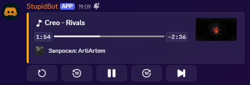
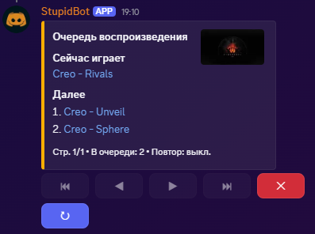
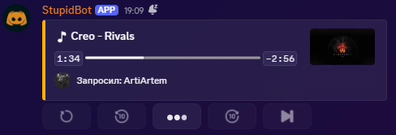
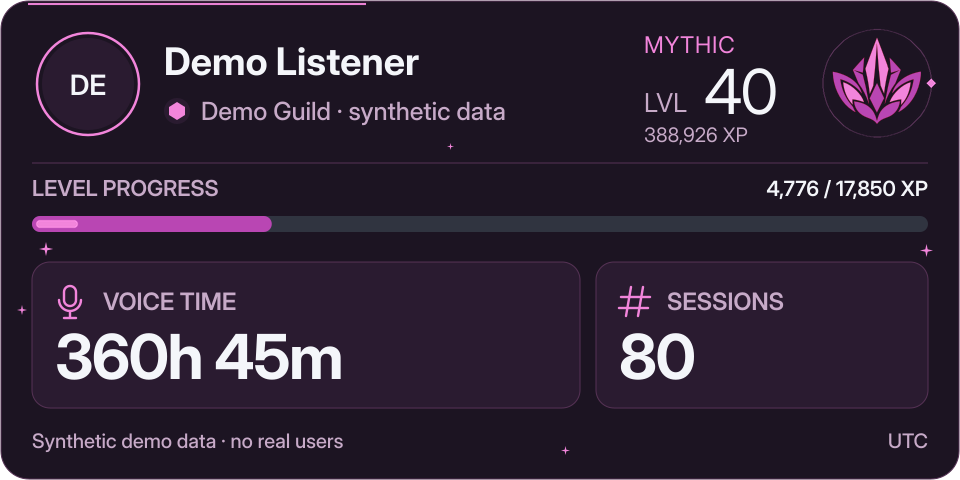
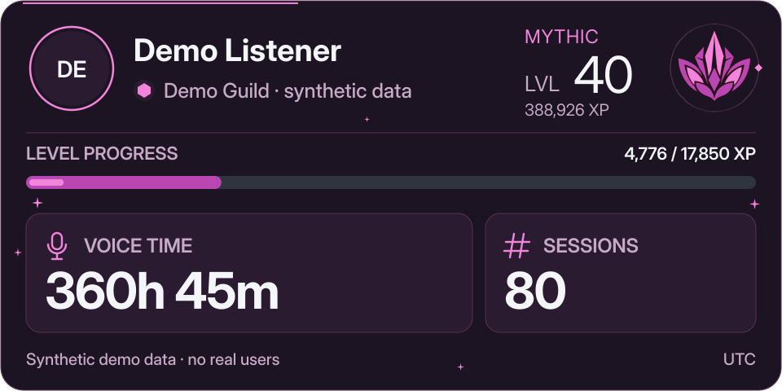
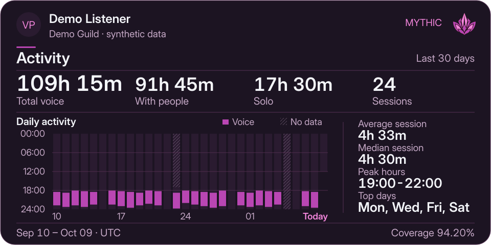
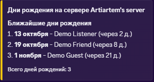

<picture>
  <source media="(prefers-color-scheme: dark)" srcset="docs/assets/banner-dark.png">
  <source media="(prefers-color-scheme: light)" srcset="docs/assets/banner-light.png">
  
</picture>

# StupidBot

[](https://www.python.org/)
[](https://github.com/Rapptz/discord.py)
[](https://lavalink.dev/)
[](https://www.sqlite.org/)
<br>
[](https://github.com/astral-sh/uv)
[](https://github.com/astral-sh/ruff)
[](https://docs.basedpyright.com/)
[](https://github.com/astral-sh/ty)
[](https://github.com/j178/prek)
[](https://github.com/ArtiArtem8/stupid-bot-discord/actions/workflows/ci.yml)
[](https://app.codacy.com/gh/ArtiArtem8/stupid-bot-discord/dashboard)
[](https://scrutinizer-ci.com/g/ArtiArtem8/stupid-bot-discord/?branch=main)
[](LICENSE)

**StupidBot** — Discord-бот с музыкой, голосовыми профилями и поздравлениями
с днём рождения. Его можно запустить у себя.

Интерфейс преимущественно русский; в карточках профиля также используется английский.

[English](README.md) · **Русский**

[Музыка](#музыка) · [Голосовые профили](#голосовые-профили) ·
[Дни рождения](#дни-рождения) · [Инженерные решения](#инженерные-решения) ·
[Локальный запуск](#локальный-запуск) · [Участие в разработке](#участие-в-разработке)

## Музыка

Запустите трек или плейлист через `/play`. Кнопки под треком позволяют начать
его заново, перемотать на десять секунд, поставить на паузу, продолжить
или пропустить.



<details>
<summary>Очередь, запись управления и команды</summary>





| Команды | Действие |
| --- | --- |
| `/play`, `/play-next` | Добавить треки или плейлисты в очередь либо поставить запрос следующим. |
| `/queue` | Показать очередь, по умолчанию только вам. |
| `/pause`, `/resume`, `/skip` | Поставить на паузу, продолжить или пропустить текущий трек. |
| `/shuffle`, `/repeat` | Перемешать очередь или переключить повтор. |
| `/rotate` | Перенести текущий трек в конец очереди. |
| `/volume` | Установить громкость от 0 до 200. |
| `/stop`, `/leave` | Остановить и очистить очередь либо отключить бота. |
| `/join`, `/reconnect` | Подключиться к голосовому каналу или переподключиться. |

</details>

Очередь по умолчанию видна только вам; после прослушивания в канале остаётся
сводка сессии. Контроллер появляется у треков длиннее 45 секунд, кроме прямых
трансляций. Для музыки нужен Lavalink; доступность YouTube, SoundCloud,
Яндекс Музыки и других источников зависит от его настроек и плагинов.
Остальные функции работают и без подключения к Lavalink.

## Голосовые профили

`/voice-profile` показывает ваш уровень, XP, время в голосовых каналах и число
сессий на текущем сервере. Кнопки Activity, People и XP добавляют подробности
в то же сообщение.



<details>
<summary>Анимированный профиль</summary>



От Starter до Rare используется PNG. Начиная с Epic — четырёхсекундный
анимированный WebP. При ошибке кодирования или превышении лимита размера
отправляется PNG.

</details>

<details>
<summary>Подробности активности</summary>



Activity охватывает последние 30 календарных дат в выбранном часовом поясе.
People показывает время с другими участниками, XP объясняет начисления и снижения.
Карточки различают отсутствие наблюдений и отсутствие активности.
Подробнее: [поведение и рендеринг профилей](docs/voice/profile-card.md),
[прогрессия XP](docs/voice/progression.md).

</details>

По умолчанию профиль виден только вам. `private:false` публикует карточку;
кнопками может пользоваться только её владелец. Refresh обновляет все
показанные карточки вместе, Delete удаляет сообщение, сохраняя историю и XP.
После десяти минут бездействия кнопки исчезают.

## Дни рождения



Участники указывают дату через `/set-birthday` и удаляют её через
`/remove-birthday`. Поддерживаются форматы `DD-MM-YYYY` и `YYYY-MM-DD`.
Администраторы выбирают канал поздравлений и необязательную роль именинника
через `/setup-birthdays`, а ближайшие даты смотрят через `/list-birthdays` —
по умолчанию список виден только вызвавшему команду. Дни рождения определяются
по локальной дате хоста; `VOICE_PROFILE_TIMEZONE` влияет только на голосовые профили.

`/settings` открывает личные настройки языка и часового пояса.
`/settings-server` настраивает общие сообщения и требует права «Управлять сервером».
«Как в Discord» сбрасывает только язык. Личные карточки используют ваши настройки,
общие — серверные; уже открытая карточка сохраняет язык и зону при обновлении.
После второго успешного вызова личного профиля бот может показать подсказку о
настройках: максимум два раза с интервалом 14 дней, с кнопками «Позже» и
«Не напоминать». Автоматических личных сообщений нет.

| Другие возможности | Команды и поведение |
| --- | --- |
| WolframAlpha | `/solve` — ответы и вычисления, `/plot` — графики. Нужен App ID. |
| Магический шар | `/ask` запоминает ответ на повторяющийся вопрос. |
| Роли участников | `/monitor` управляет сохранёнными снимками ролей и восстановлением. |
| Доступ к боту | `/block`, `/unblock`, `/block-info` и `/list-blocked`. |
| Обратная связь | `/report` сохраняет обращение; `/set-report-channel` настраивает уведомления. |
| Ответы в чате | Реакции на приветствия и подсказки о slash-командах вместо старых префиксных. |

## Инженерные решения

- **Состояние плеера учитывает конкурирующие события.** [MusicPlayer](stupidbot/features/music/playback/player.py)
  выполняет изменения очереди последовательно и присваивает каждой попытке
  воспроизведения идентификатор. [Обработчики](stupidbot/features/music/runtime/playback_events.py)
  по нему отличают запоздавшие события от текущего воспроизведения.
  [Composition](stupidbot/features/music/composition.py) связывает плеер, восстановление
  и интерфейс Discord.
- **Профили читают временную шкалу из памяти.** [VoiceAnalytics](stupidbot/features/voice/runtime.py)
  восстанавливает её при запуске и обновляет после фиксации записей журнала.
  В штатном режиме профили используют снимки без SQL-запросов к сырой истории.
  [Архитектура голосовой подсистемы](docs/voice/architecture.md) описывает
  сессии, пробелы в наблюдениях и восстановление.
- **Одна база и явный порядок завершения работы.** [Database](stupidbot/storage/database.py)
  обслуживает все функции с постоянными данными. При выключении бот останавливает
  источники записей, завершает принятые записи голосовой истории и сохраняет uptime,
  затем дожидается транзакций и закрывает базу. [Документация хранилища](docs/storage/README.md)
  описывает явные миграции, офлайн-импорт, резервные копии и восстановление.

## Локальный запуск

Нужны **Python 3.12**, Git, [uv](https://docs.astral.sh/uv/getting-started/installation/)
и приложение бота из [Discord Developer Portal](https://discord.com/developers/applications).
На странице Bot включите привилегированные intents: **Presence**, **Server Members**
и **Message Content**. Добавьте приложение на сервер со scopes бота и команд
приложения. Выдайте права на сообщения, вложения и голосовое воспроизведение,
а для ролей именинников и восстановления ролей — ещё и на управление ролями.

### Установка и настройка

```bash
git clone https://github.com/ArtiArtem8/stupid-bot-discord.git
cd stupid-bot-discord
uv sync --locked --no-dev
```

Скопируйте [.env.example](.env.example) в `.env` (`cp .env.example .env` в POSIX shell
или `Copy-Item .env.example .env` в PowerShell). До запуска укажите `DISCORD_BOT_TOKEN`.

| Параметр | Назначение |
| --- | --- |
| `DISCORD_BOT_TOKEN` | Обязательный токен Discord-бота. |
| `DISCORD_BOT_OWNER_ID` | Необязательный ID владельца. |
| `VOICE_PROBE_ENABLED` | По умолчанию `true`: сбор голосовой активности. Наблюдения хранятся в SQLite бессрочно. |
| `VOICE_PROFILE_TIMEZONE` | Часовой пояс IANA для календарных подробностей профиля; без значения — `UTC`. Для новой установки пример предлагает явно выбрать `Europe/Moscow`. При обновлении сохраните прежнее значение. Не меняет длительность пребывания в голосе или суммарный XP. |
| `WOLFRAM_APP_ID` | [App ID WolframAlpha](https://developer.wolframalpha.com/) для `/solve` и `/plot`; остальным функциям не нужен. |
| `LAVALINK_HOST`, `LAVALINK_PORT` | Адрес Lavalink, по умолчанию `localhost:2333`. |
| `LAVALINK_PASSWORD`, `LAVALINK_SECURE` | Пароль и настройка TLS должны совпадать с сервером Lavalink. |

Для музыки запустите [Lavalink](https://lavalink.dev/getting-started/) отдельно
и настройте нужные плагины источников. Требование к Java смотрите в инструкции
для выбранной версии Lavalink.

Для профилей установите **Inkscape** на хост бота и сохраните поставляемые
[шрифты Inter](stupidbot/assets/fonts/). Проверьте `inkscape --version` от имени учётной
записи службы. Без Inkscape или шрифтов команда профиля недоступна; остальные
функции могут запускаться. Подробнее: [настройка рендерера](docs/voice/profile-card.md#setup).
Пользовательские emoji приложения из [shared emoji references](stupidbot/discord_ui/emojis.py) и
[музыкального контроллера](stupidbot/features/music/discord/views/controller.py) должны быть доступны вашему боту.

### Подготовка базы и запуск

Для **новой установки** создайте и проверьте базу SQLite:

```bash
uv run --locked --no-dev python -c "from pathlib import Path; Path('data').mkdir(exist_ok=True)"
uv run --locked --no-dev python -m stupidbot.storage --database data/app.sqlite migrate
uv run --locked --no-dev python -m stupidbot.storage --database data/app.sqlite check
uv run --locked --no-dev main.py
```

> [!IMPORTANT]
> Запуск требует подготовленной базы. Отсутствующие, несовместимые и
> незавершённые файлы отклоняются. Для существующей установки сначала изучите
> [миграцию и восстановление](docs/storage/README.md):
> команды выше не импортируют старые данные.

Другой подготовленный файл можно выбрать так:

```bash
uv run --locked --no-dev main.py --database /path/to/app.sqlite
```

<details>
<summary>Скрипты запуска и эксплуатационные настройки</summary>

Из корня репозитория бот запускается через `./runstupidbot.sh` (Linux/macOS)
или `.\runstupidbot.bat` (Windows PowerShell).

`LAVALINK_NODE_LABEL` по умолчанию равен `MAIN`, `LAVALINK_CONNECT_RETRY_DELAY` —
30 секундам. Пути рендерера, права на кеш шрифтов и `INKSCAPE_BIN` описаны
в [настройке профилей](docs/voice/profile-card.md#setup).

Рабочие файлы используют `data/` и временные каталоги рендерера. Резервные копии
создаются отдельными командами обслуживания SQLite. В [stupidbot/settings.py](stupidbot/settings.py)
находятся эксплуатационные константы, в [общих эмодзи](stupidbot/discord_ui/emojis.py) —
ссылки на элементы управления; [настройка логирования](stupidbot/app/logging.py)
управляет журналами. Тексты остальных функций находятся рядом с их кодом.

Отслеживание выделения памяти по умолчанию выключено.
`uv run --locked --no-dev main.py --tracemalloc` включает его для диагностики,
увеличивая нагрузку на CPU и потребление памяти.

</details>

## Участие в разработке

Настройка окружения разработчика и проверки Ruff, basedpyright, ty, pytest
и prek описаны в [CONTRIBUTING.md](CONTRIBUTING.md). Техническая документация
написана на английском.

## Лицензия и графика

[MIT](LICENSE). Баннер использует эмблему профиля и музыкальную палитру бота;
редактируемые SVG находятся в [docs/assets/](docs/assets/).
Часть иконок интерфейса предоставлена [Icons8](https://icons8.com);
файлы находятся в [stupidbot/discord_ui/assets/emojis/](stupidbot/discord_ui/assets/emojis/). Inter распространяется
по [SIL Open Font License](stupidbot/assets/fonts/OFL.txt).
